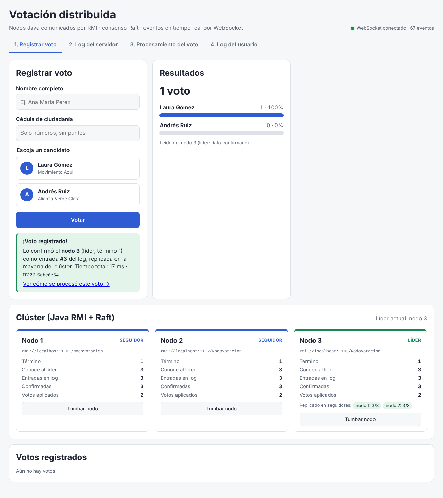
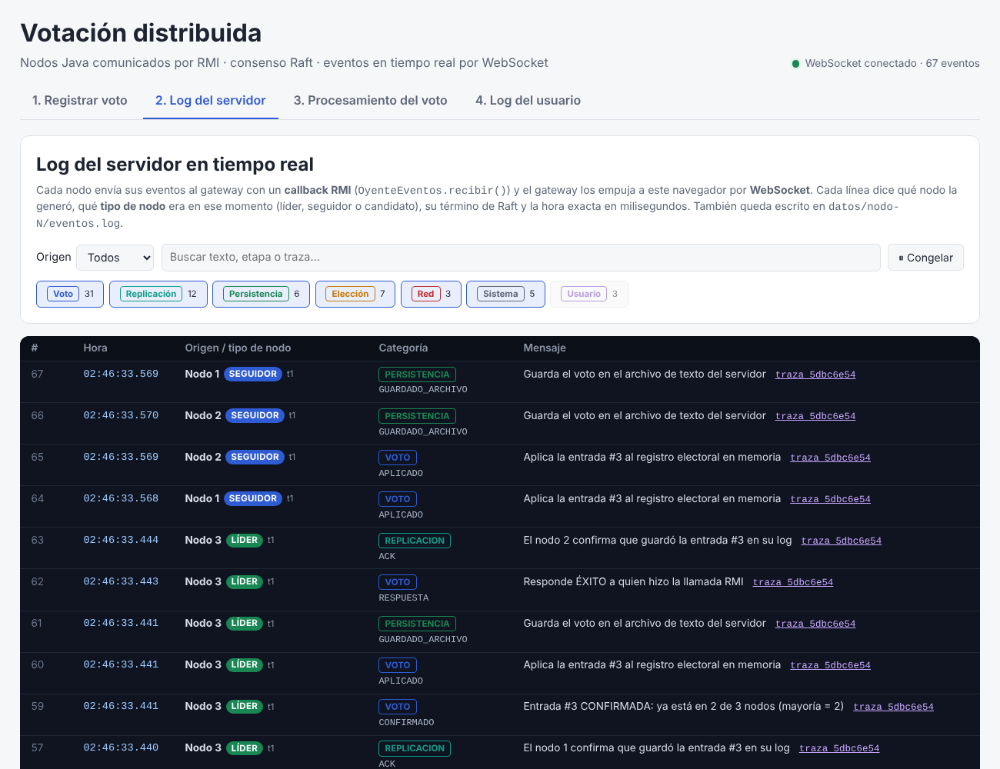
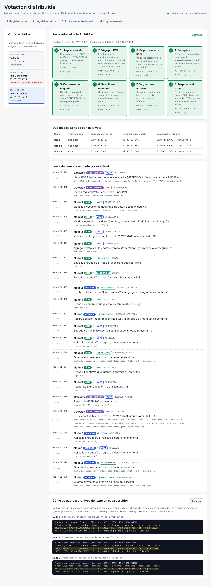
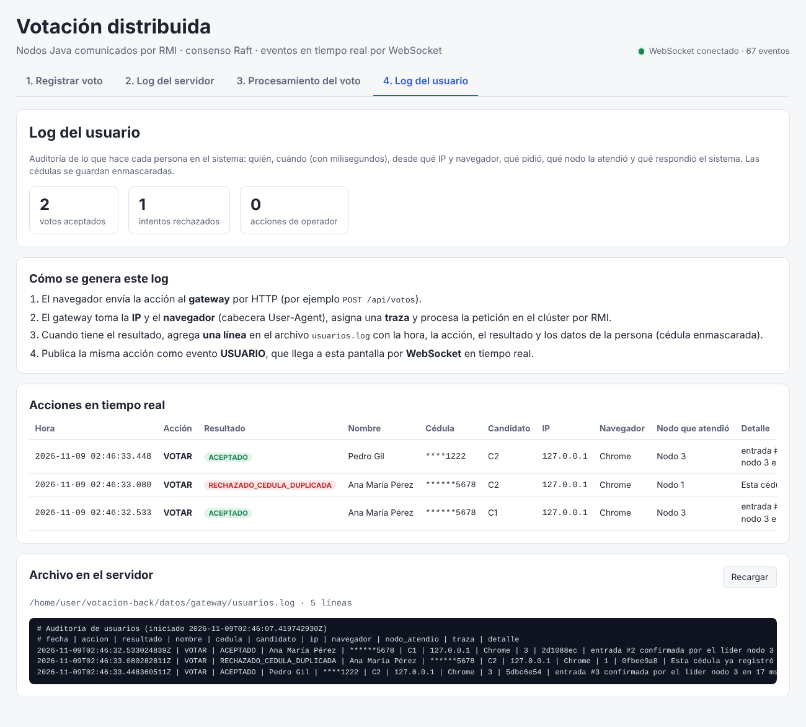

# votacion-front

Frontend en **Angular** del sistema distribuido de votación. El backend está en [votacion-back](https://github.com/danyelk63/votacion-back): nodos Java comunicados por **RMI** y coordinados con el consenso **Raft**.

Todo lo que pasa en el servidor llega a la pantalla **en tiempo real por WebSocket**, con la hora exacta (en milisegundos) y el **tipo de nodo** que lo procesó (líder, seguidor, candidato o gateway).

## Las 4 vistas

| Vista | Ruta | Qué muestra |
|---|---|---|
| 1. Registrar voto | `/votar` | Formulario (nombre, cédula, candidato), resultados, estado del clúster con botones para tumbar o reanudar nodos, y lista de votos |
| 2. Log del servidor | `/log-servidor` | Consola en vivo con todos los eventos del gateway y de cada nodo. Se puede filtrar por nodo, categoría o texto, y congelar la consola |
| 3. Procesamiento del voto | `/procesamiento` | Recorrido completo de un voto: cómo **llega** (HTTP → RMI), cómo se **procesa** (validación, log, replicación, mayoría) y cómo se **guarda** (`votos.txt` de cada nodo). Incluye la línea de tiempo con +ms y lo que hizo cada nodo |
| 4. Log del usuario | `/log-usuario` | Auditoría: quién votó, cuándo, desde qué IP y navegador, con qué resultado y qué nodo lo atendió. Explica cómo se genera el log y muestra el archivo `usuarios.log` |






## Cómo se conecta

```
Navegador ──HTTP /api──► Gateway Java :8080 ──RMI──► Nodos 1, 2, 3 (:1101-1103)
Navegador ◄──WebSocket /ws── Gateway :8081 ◄──callback RMI── Nodos
```

- El navegador no puede hablar RMI, así que usa **REST** para las acciones y un **WebSocket** para recibir los eventos.
- Los nodos le envían cada evento al gateway con un **callback RMI**, y el gateway lo reenvía por el WebSocket.
- En desarrollo, `ng serve` redirige `/api` a `localhost:8080` y `/ws` a `localhost:8081` (ver [`proxy.conf.json`](proxy.conf.json)). Si el gateway corre en otra máquina, cambie los `target` de ese archivo.

## Ejecutar

1. Levantar el backend en `votacion-back`: `mvn package && ./scripts/cluster.sh` (en Windows: `scripts\cluster.bat`).
2. En este repo:

```bash
npm install
npm start          # http://localhost:4200
```

## Estructura

| Archivo | Rol |
|---|---|
| `src/app/core/eventos.ts` | Conexión WebSocket con reconexión automática; expone los eventos como signal |
| `src/app/core/votacion-api.ts` | Cliente HTTP del gateway |
| `src/app/paginas/votar/` | Vista 1 |
| `src/app/paginas/log-servidor/` | Vista 2 |
| `src/app/paginas/procesamiento/` | Vista 3 |
| `src/app/paginas/log-usuario/` | Vista 4 |
| `src/app/compartido/origen.ts` | Etiqueta "Nodo N · tipo de nodo · término" |
| `src/app/compartido/hora.ts` | Hora local con milisegundos |
