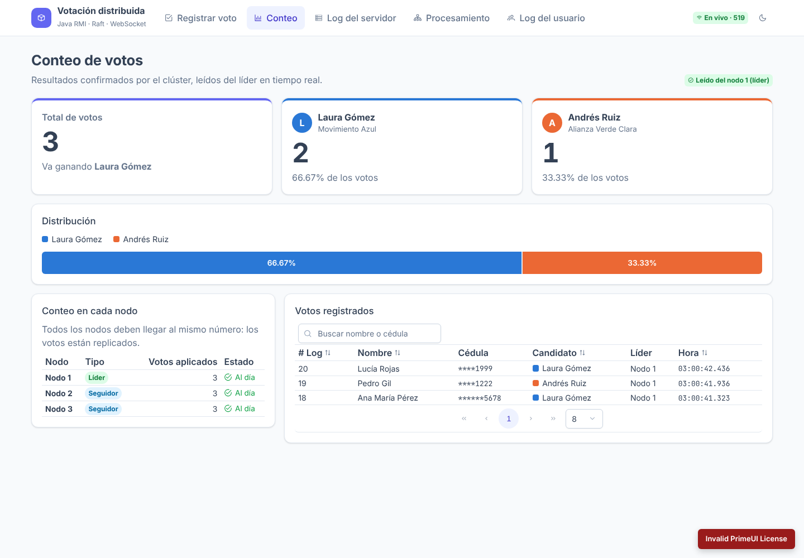
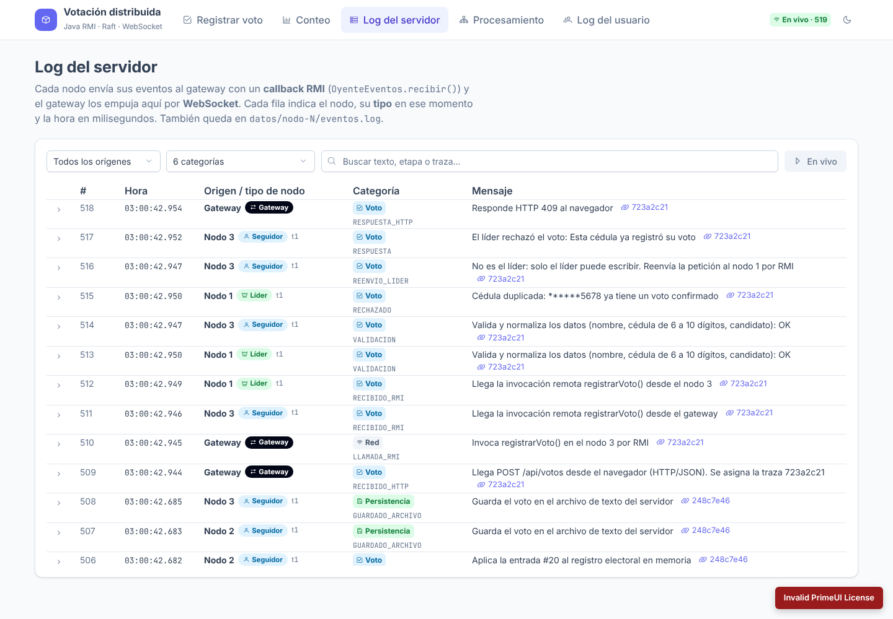
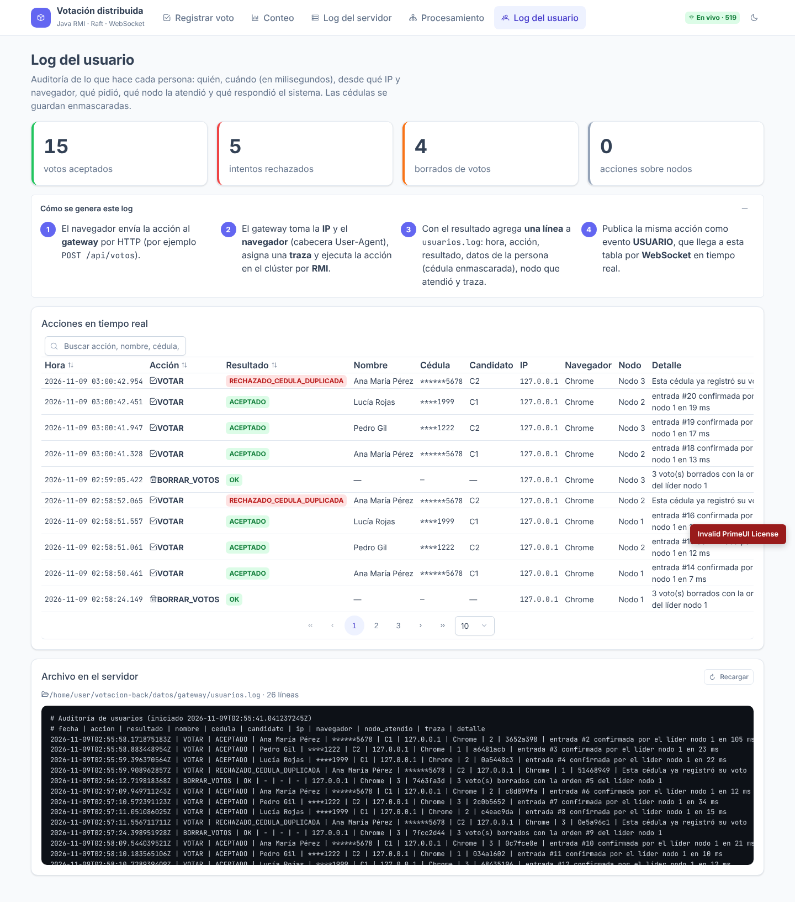
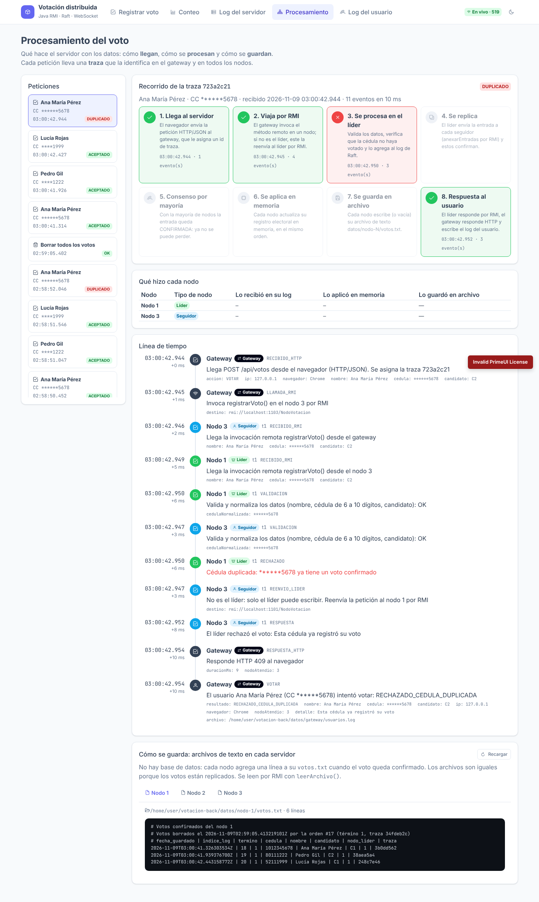
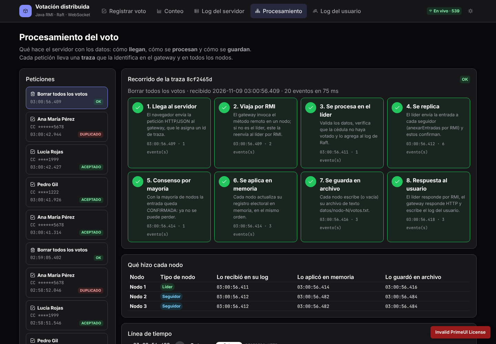

# votacion-front

Frontend en **Angular 22 + PrimeNG 22** (tema Aura, modo claro y oscuro) del sistema distribuido de votación. El backend está en [votacion-back](https://github.com/danyelk63/votacion-back): nodos Java comunicados por **RMI** y coordinados con el consenso **Raft**.

**Publicado en:** https://votacion-front.vercel.app (backend: https://votacion-back-u8f6.onrender.com)

Todo lo que pasa en el servidor llega a la pantalla **en tiempo real por WebSocket**, con la hora exacta en milisegundos y el **tipo de nodo** que lo procesó: líder, seguidor, candidato o gateway.

## Vistas

| Vista | Ruta | Qué muestra |
|---|---|---|
| Registrar voto | `/votar` | Formulario (nombre, cédula, candidato), conteo resumido, estado del clúster con botones para tumbar o reanudar nodos, y botón **Borrar todos los votos** con confirmación |
| Conteo | `/conteo` | Total y votos por candidato, barra de distribución, conteo en cada nodo (para ver la réplica) y tabla de votos con búsqueda, orden y paginación |
| Log del servidor | `/log-servidor` | Todos los eventos del gateway y de cada nodo en vivo. Filtros por origen, categoría y texto; se puede congelar y expandir cada fila |
| Procesamiento | `/procesamiento` | Recorrido de cada petición en 8 fases: llega (HTTP → RMI), se procesa, se replica, consenso, se aplica, se guarda en `votos.txt` y se responde. Incluye línea de tiempo, qué hizo cada nodo y los archivos de cada nodo |
| Log del usuario | `/log-usuario` | Auditoría: quién, cuándo, IP, navegador, resultado, nodo y traza. Explica cómo se genera el log y muestra `usuarios.log` |

**Borrar todos los votos** no borra en un solo nodo. Envía `DELETE /api/votos`, que se replica por Raft como una entrada más del log. Así, todos los nodos borran lo mismo en el mismo punto y vacían su `votos.txt`. El borrado queda trazado como cualquier voto.

| | |
|---|---|
|  |  |
|  |  |
|  |  |

## Licencia de PrimeNG

Desde la versión 20, PrimeNG usa la **PrimeUI License**. Sin clave, PrimeNG funciona igual, pero muestra el aviso *"Invalid PrimeUI License"*.

Para estudiantes y proyectos académicos, la licencia **Community es gratuita**:

1. Pida la clave en <https://primeui.dev/licenses/community>.
2. Péguela en [`src/app/licencia-primeng.ts`](src/app/licencia-primeng.ts).

## Cómo se conecta

```
Navegador ──HTTP /api──► Gateway Java :8080 ──RMI──► Nodos 1, 2, 3 (:1101-1103)
Navegador ◄──WebSocket /ws── Gateway :8081 ◄──callback RMI── Nodos
```

En desarrollo, `ng serve` redirige `/api` a `localhost:8080` y `/ws` a `localhost:8081` (ver [`proxy.conf.json`](proxy.conf.json)).

## Ejecutar

1. Levantar el backend en `votacion-back`: `mvn package && ./scripts/cluster.sh` (en Windows: `scripts\cluster.bat`).
2. En este repo:

```bash
npm install
npm start          # http://localhost:4200
```

## Publicación

- **Frontend → Vercel.** Ver [`vercel.json`](vercel.json). En producción, [`environment.prod.ts`](src/environments/environment.prod.ts) apunta la API y el WebSocket directo a Render, porque Vercel no hace de proxy para WebSocket.
- **Backend → Render**, plan gratuito, con Docker (ver el README de `votacion-back`). Si el servidor estaba dormido, la app muestra un aviso mientras despierta (hasta ~1 minuto).

## Estructura

| Carpeta / archivo | Rol |
|---|---|
| `src/app/tema.ts` | Preset de PrimeNG (Aura + primario índigo) |
| `src/app/core/eventos.ts` | Conexión WebSocket con reconexión automática; expone los eventos como signal |
| `src/app/core/votacion-api.ts` | Cliente HTTP del gateway |
| `src/app/componentes/` | Formulario de voto y panel del clúster |
| `src/app/paginas/` | Una carpeta por vista |
| `src/app/compartido/` | Etiqueta de origen y tipo de nodo, categorías, hora con milisegundos |

Los colores de los candidatos (azul y naranja) están validados para daltonismo y contraste, en modo claro y oscuro.
