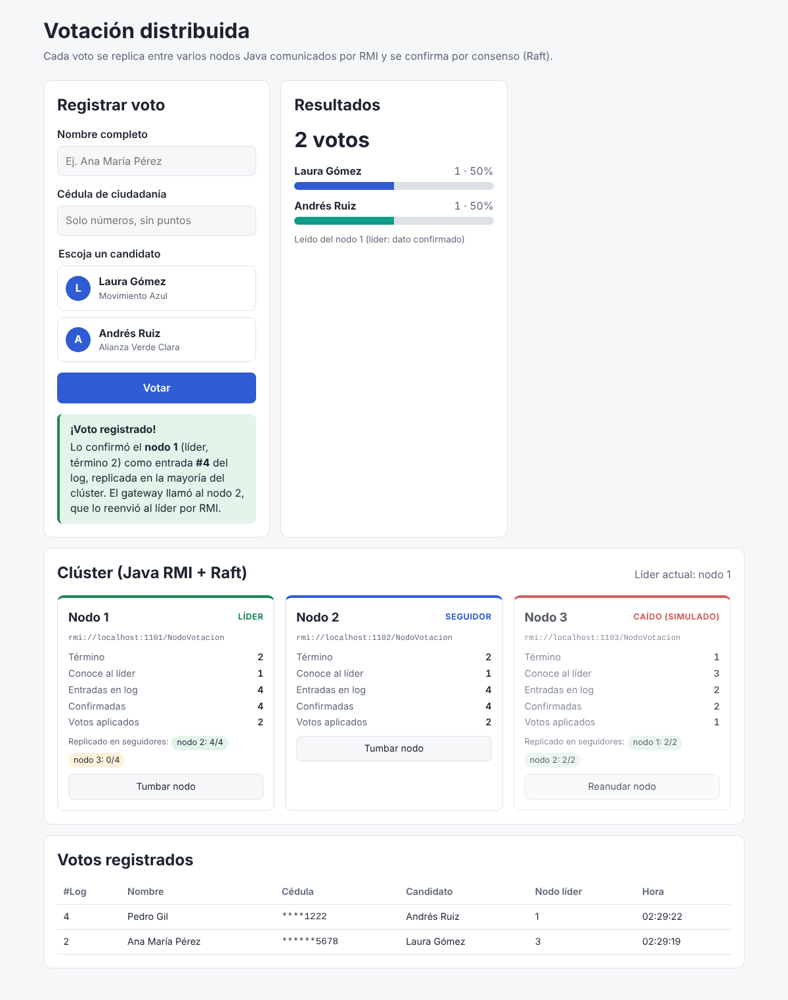

# votacion-front

Frontend en **Angular** del sistema distribuido de votación. El backend está en [votacion-back](https://github.com/danyelk63/votacion-back): nodos Java comunicados por **RMI** y coordinados con el consenso **Raft**.



## Qué muestra

- **Registrar voto**: nombre, cédula de ciudadanía y uno de los 2 candidatos. Al confirmar, indica qué nodo líder lo aceptó, en qué término y en qué posición del log quedó. Si la petición entró por un seguidor, indica que este la reenvió al líder por RMI.
- **Resultados**: conteo y porcentaje en vivo, y desde qué nodo se leyeron.
- **Panel del clúster**: rol de cada nodo (líder, seguidor o candidato), término, tamaño del log, entradas confirmadas y avance de la replicación en cada seguidor. Los botones **Tumbar nodo** y **Reanudar nodo** sirven para mostrar en vivo la elección de un nuevo líder y la recuperación.
- **Votos registrados**: el log aplicado, con la cédula enmascarada.

## Cómo se conecta

```
Navegador ──HTTP /api──► Gateway Java :8080 ──RMI──► Nodos 1, 2, 3 (:1101-1103)
```

El navegador no puede hablar RMI, así que el front llama por REST al gateway y el gateway hace las llamadas RMI. En desarrollo, `ng serve` redirige `/api` a `http://localhost:8080` (ver [`proxy.conf.json`](proxy.conf.json)). Si el gateway corre en otra máquina, cambie el `target` de ese archivo.

## Ejecutar

1. Levantar el backend (en `votacion-back`): `mvn package && ./scripts/cluster.sh`. En Windows: `scripts\cluster.bat`.
2. En este repo:

```bash
npm install
npm start          # http://localhost:4200
```

## Estructura

| Archivo | Rol |
|---|---|
| `src/app/core/votacion-api.ts` | Cliente HTTP del gateway |
| `src/app/core/sondeo.ts` | Consulta periódica (polling) expuesta como signal |
| `src/app/formulario-voto/` | Formulario con validación (nombre, cédula de 6 a 10 dígitos, candidato) |
| `src/app/resultados/` | Barras de resultados |
| `src/app/panel-cluster/` | Monitoreo del clúster y simulación de caídas |
| `src/app/lista-votos/` | Tabla de votos registrados |

## Scripts

- `npm start`: servidor de desarrollo con proxy al gateway.
- `npm run build`: compilación de producción en `dist/`.
- `npm test`: pruebas unitarias (Vitest).
